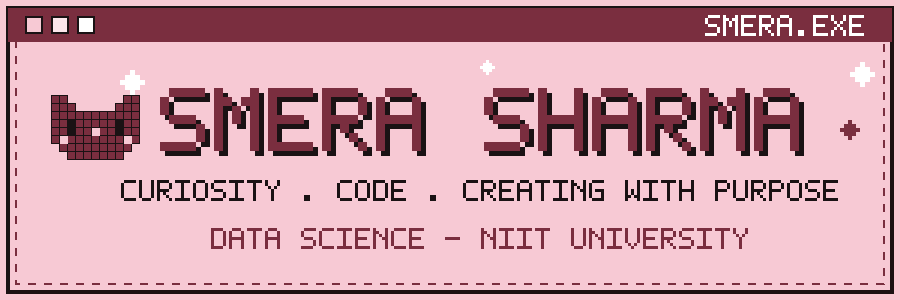
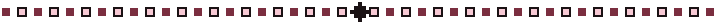

<div align="center">

<a href="https://github.com/smera-sharma"></a>


<a href="https://github.com/smera-sharma"></a>
<a href="https://www.linkedin.com/in/smmera-sharrma-a9a2013a2/"></a>
<a href="mailto:smmerasharrma@gmail.com"></a>

  




</div>

Hey! I'm Smera, a third-year B.Tech Computer Science student specializing in Data Science at NIIT University.

I'm fascinated by the space where technology meets people.

I like understanding how things work, questioning why they work that way, and figuring out how they could work better.

My interests have taken me from machine learning and explainable AI to cryptographic security, social-impact technology, and projects that explore human behavior.

I'm still learning, experimenting, making mistakes, and occasionally wondering why my code worked five minutes ago but doesn't anymore.

But that's part of the fun.

```python
class Smera:
    education = "B.Tech CSE | Data Science"
    university = "NIIT University"

    interests = [
        "Artificial Intelligence",
        "Machine Learning",
        "Human-Centered AI",
        "Explainable AI",
        "Ethical Technology"
    ]

    currently_exploring = [
        "NLP",
        "Deep Learning",
        "Java & DSA",
        "Research in AI and Security"
    ]

    believes_in = "Technology should make a difference."
```

<div align="center">


</div>

- ✦ **AI & Machine Learning:** Understanding how machines learn, recognize patterns, and solve problems.
- ✦ **Human-Centered AI:** Exploring technology that considers the people using it.
- ✦ **Explainable AI:** Because getting an answer isn't enough; understanding *why* matters too.
- ✦ **Ethical Technology:** Thinking about fairness, responsibility, and the impact of the systems we build.
- ✦ **Research:** Exploring questions that don't always have straightforward answers.

<div align="center">


</div>

I enjoy exploring the research side of computer science, especially questions where AI intersects with security, transparency, and real-world decision-making.

Some areas I've been working around:

**✦ Explainable AI & Credit Risk**<br>
Exploring credit default prediction using Random Forest and SHAP to make model decisions more interpretable.

**✦ Machine Learning & Cryptographic Security**<br>
Investigating whether machine learning can help evaluate randomness in cryptographic generators and identify potential weaknesses.

I'm particularly interested in research that goes beyond model accuracy and asks what a system actually tells us.

<div align="center">


</div>

A few projects that reflect the kinds of problems I enjoy exploring.

### ✦ [Study Sync AI](https://github.com/smera-sharma/Studysync-AI)

*Making the learning process a little smarter.*

An AI-focused project exploring ways to make studying and learning more organized and effective.

`AI` `Python` `Learning Technology`

### ✦ [Carbon Credit Dashboard](https://github.com/smera-sharma/carbon-credit-dashboard)

*Data meets sustainability.*

A project centered around carbon credit estimation and presenting environmental information through a data-driven dashboard.

`Data Science` `Dashboard` `Sustainability`

### ✦ [Unwind](https://github.com/smera-sharma/unwind-student-stress-reflection)

*Because technology should care about people, too.*

A student stress and reflection application built around encouraging mindfulness, self-reflection, and emotional well-being.

`React` `Tailwind CSS` `FastAPI` `SQLite`

### ✦ SUNWAI — AI for Social Impact

*Technology that listens.*

A prototype exploring AI-assisted distress detection and prioritization for India's National Helpline Against Atrocities.

The idea brings together speech analysis, distress indicators, and intelligent prioritization to explore how technology could support more responsive assistance.

`AI` `NLP` `Speech Analysis` `Social Impact`

<div align="center">


</div>

**Currently strengthening:** Python · Java · Machine Learning · Data Structures & Algorithms · NLP

<div align="center">


</div>

Not everything interesting happens in a code editor.

I've also enjoyed being part of the creative, collaborative, and organizational side of university life.

- ✦ SPOC – TEDxNIITUniversity '25
- ✦ Core Team – College Fest
- ✦ On-fest Team – Ingenuity
- ✦ Mentor – Camp Future

These experiences have taught me that building something meaningful also takes communication, creativity, teamwork, and the ability to bring people together.

<div align="center">


</div>

Always happy to connect with people who enjoy exchanging ideas, building interesting things, exploring research, or simply learning something new.

<div align="center">

<a href="mailto:smmerasharrma@gmail.com"></a>
<a href="https://www.linkedin.com/in/smmera-sharrma-a9a2013a2/"></a>

<br>

<i>"Stay curious. Build things. Make them matter."</i>


<sub>✦ &nbsp;still figuring it out. still building.&nbsp; ✦</sub>

</div>

